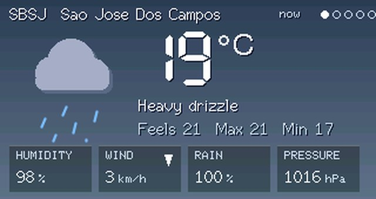
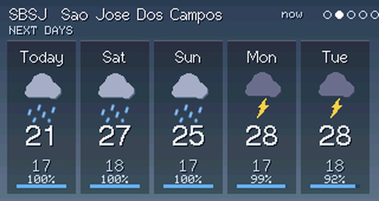
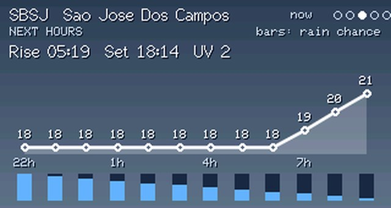
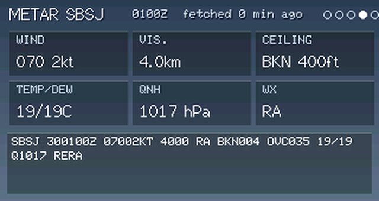
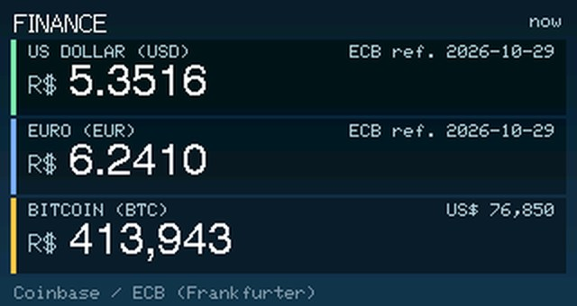
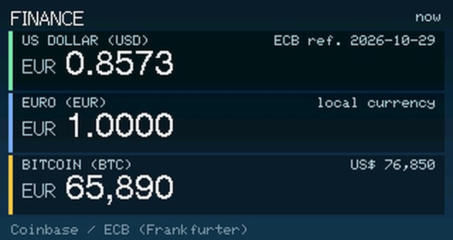
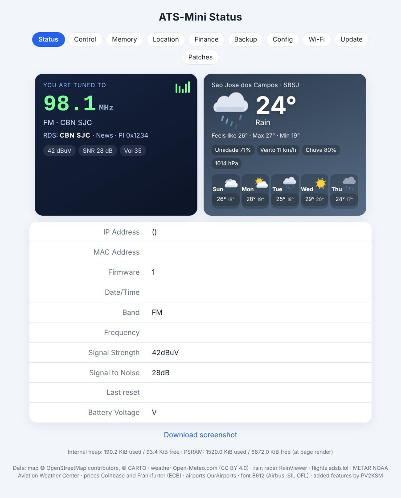
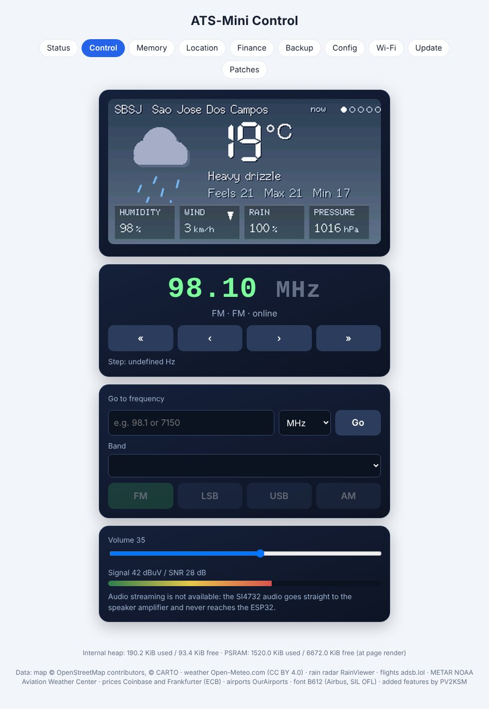
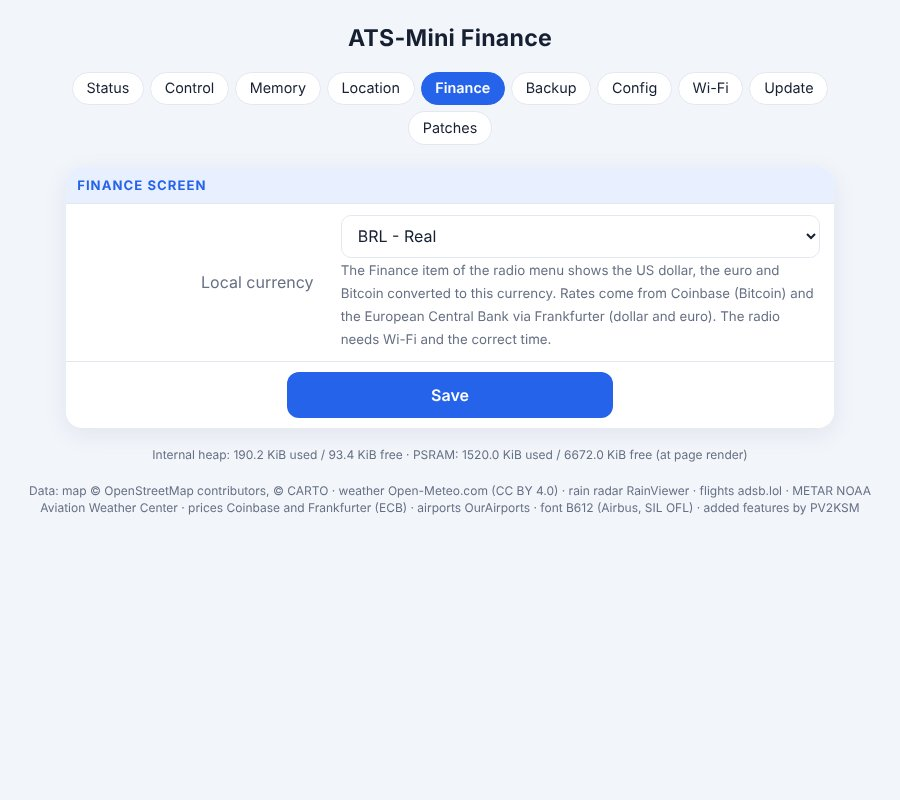
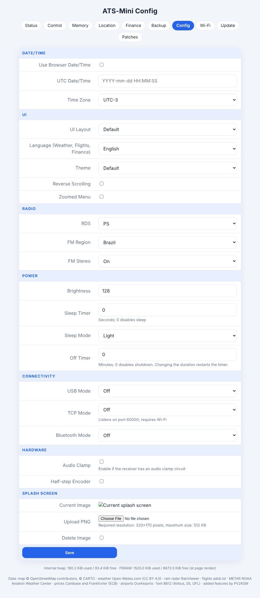

# PV2KSM mod r30 - user manual

Unofficial community mod based on ATS-Mini v2.45 (MIT). Only the **OSPI** variant is tested on real hardware (and r30 itself is still untested on the radio: see *What is not tested*). Anything not described here works as in the [official manual](../source/manual.md).

Other languages: [PT](MANUAL-pt.md) · [ES](MANUAL-es.md)

## Language

The mod's screens (Flights, Weather, Finance, Network, METAR, rain radar) and the web interface speak **English, Portuguese and Spanish**. A fresh install starts in **English**.

1. On the radio: **Menu → Settings → Language**, rotate to choose, click to confirm.
2. In the browser: **Config → Language**, then Save.

The radio screens use only ASCII letters (no accents) because the built-in fonts have none. Status messages already on screen keep the old language until the next update. The choice is stored in the radio and is included in the Backup file.

## Controls (encoder)

| Action | What it does |
|---|---|
| Rotate | Tune, move in menus, change values |
| Click | Open the menu / enter an item / go back |
| Short press (hold ~0.5 s) | Context action (see each screen) |
| Long press (>2 s) | Sleep on/off |

## Main menu

Mode · Band · Volume · VFO A/B · Step · Seek · Scan · Memory · Squelch · Bandwidth · AGC/ATTN · AVC · SoftMute · **Flights** · **Weather** · **Finance** · **Network** · Settings

Items in bold are new in this mod.

### Flights
Live aircraft around your position (adsb.lol) on a map with nearby airports.
- Rotate: select the next/previous aircraft.
- Short press: open/close the details panel.
- Click: leave the screen.
- Colours show altitude: orange < 5 000 ft, yellow < 15 000 ft, green < 30 000 ft, blue above.
- Set your position in the web **Location** tab.
- Limitation: in dense areas it is crowded and may be slow or fail.

### Weather
Rotate to change page: **now → next days → next hours → METAR → rain radar**. Short press on the radar zooms; click leaves. Data is fetched only while the screen is open (needs Wi-Fi and correct time). METAR uses the ICAO set in **Location**.

### Finance
Shows the **US dollar, the euro and Bitcoin** converted to your local currency (choose it in the web **Finance** tab). Rates: Coinbase (Bitcoin) and the European Central Bank via Frankfurter (dollar, euro). Number format follows the language (EN `1,234.56`; PT/ES `1.234,56`).

### Network
Two pages (rotate): Network (Wi-Fi, IP, channel, MAC, time, uptime, memory, last reset) and Services (state of Flights, Map, Weather, METAR, Radar, Finance).

## Web interface (open the radio's IP in a browser)

| Tab | Use |
|---|---|
| Status | "You are tuned to" card, weather, system info |
| Control | Live radio screen, tuning, go to frequency, band/mode, volume |
| Memory | Edit memory slots |
| Location | Airport ICAO or lat/lon, name, label, map options |
| Finance | Local currency |
| Backup | Export/import settings; keep "include Wi-Fi networks" **off** if you share the file |
| Config | Date/time, layout, **language**, theme, power, hardware |
| Wi-Fi | Mode and saved networks |
| Update | Check for updates / manual `.bin` upload |
| Patches | Experimental Si4732 patch sets |

## Screenshots

**Radio screens (simulated renders)**

**Web pages (simulated with sample data)**

## Map key (optional)

The map background needs your own free CARTO basemaps key (<https://carto.com/basemaps/apikey/>). Enter it in **Location**; it stays in your radio and is never shown back. The firmware never contains a key.

## Installing

Download the `.bin` for your variant from the release page, open the radio's web UI → **Update → Manual upload**. OSPI is the tested variant; QSPI and LilyGO T-Embed are only compiled.

## What is not tested

- r30 (language switch, Finance with euro, translated web pages) has **not yet been tested on the radio**.
- QSPI and LilyGO T-Embed builds: compiled only.
- Cockpit and Avionics layouts: need more hardware testing.
- Backup import was not tested on hardware.

## Known limitations

- Flights in dense areas do not work well.
- With a weak battery the radio can keep rebooting while Wi-Fi is on (charge it or turn Wi-Fi off). A user reported ~170 mA with Wi-Fi (reported, not measured by me).
- Open-Meteo is free for non-commercial use only; other services keep their own terms (see `AVISOS-DE-TERCEIROS.md`).

## Plans

Units option (km/h, mph, kt), a second weather location, and a **lite version** (lighter map or no map). No dates.

Feedback and bug reports: https://github.com/PV2KSM/ats-mini-pv2ksm/issues — 73, PV2KSM
