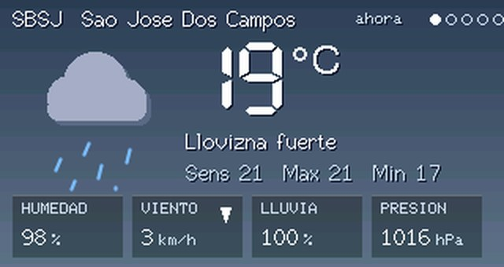
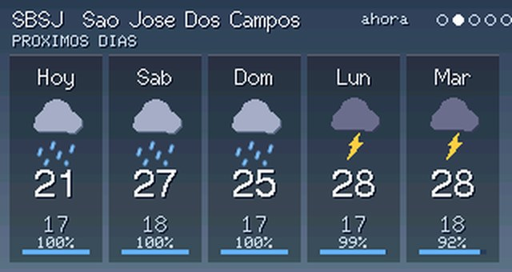
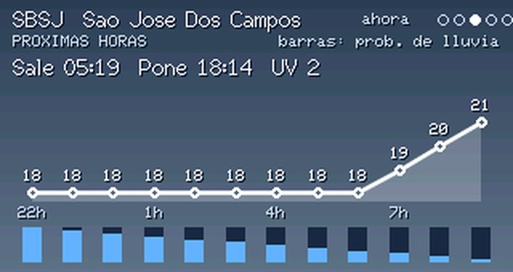
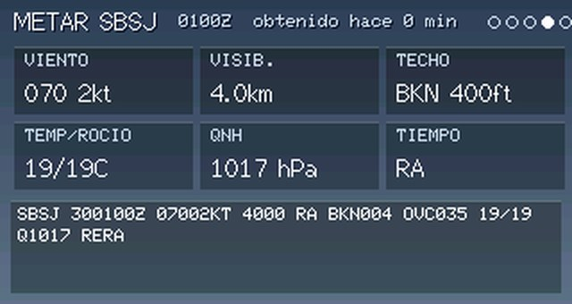
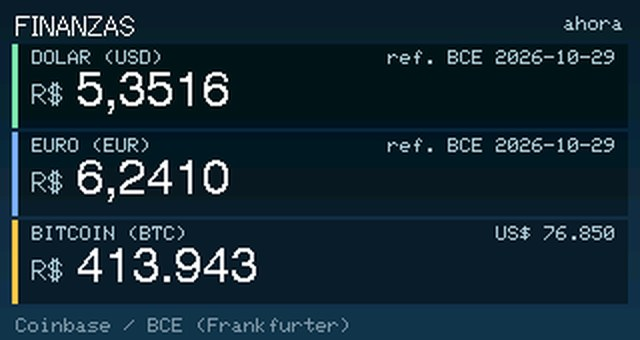
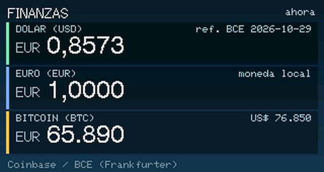
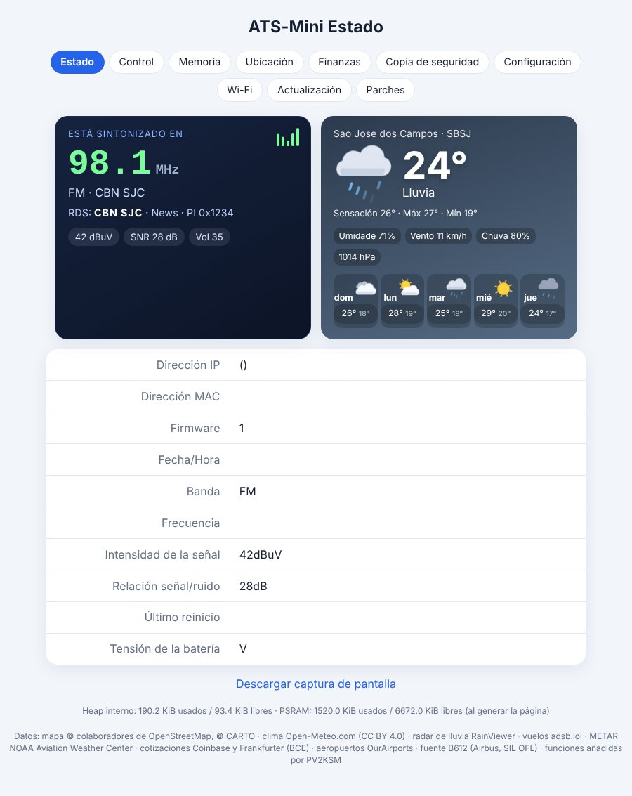
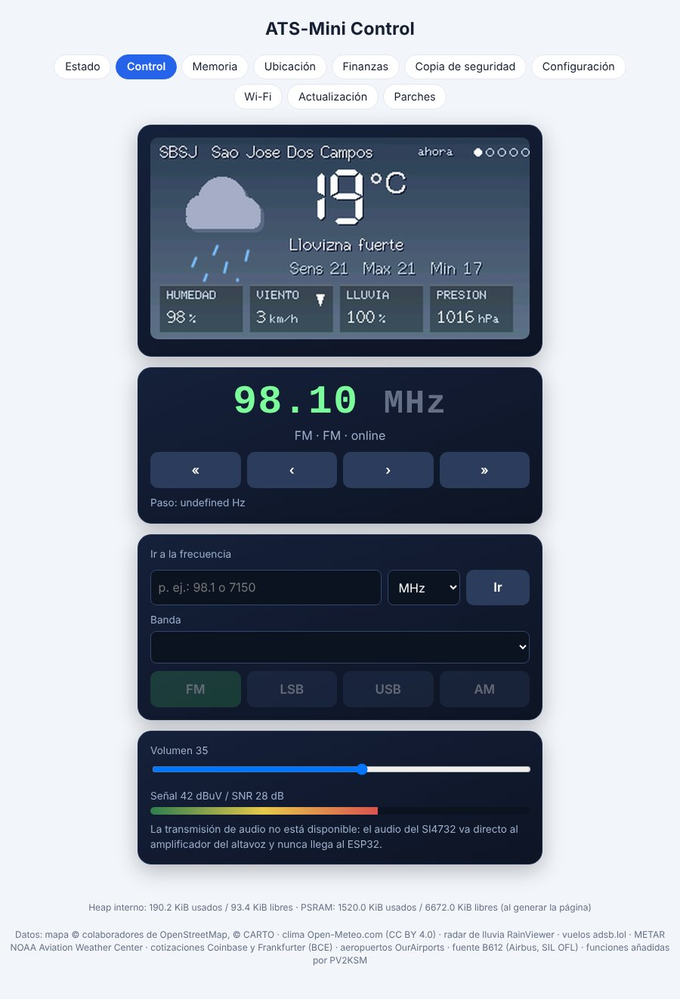
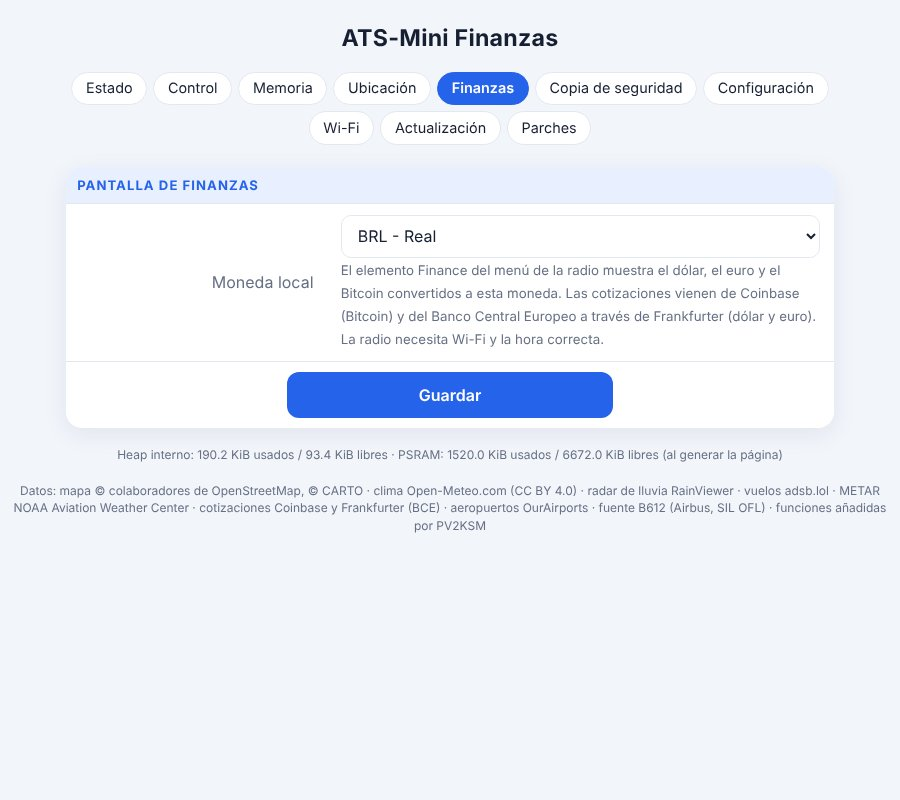
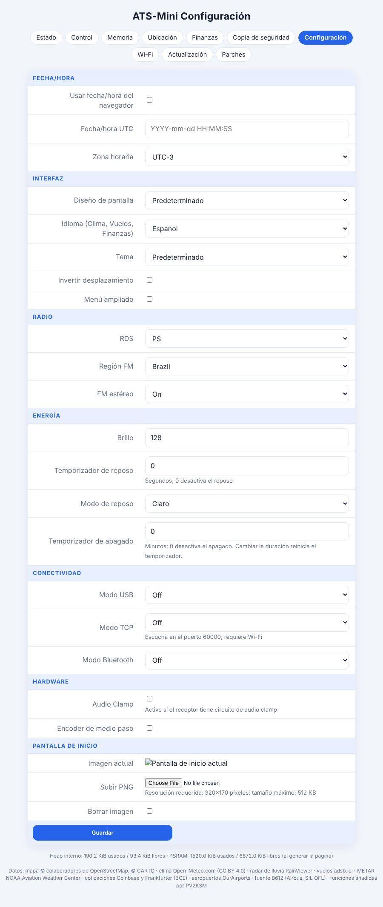

# Mod PV2KSM r30 - manual del usuario

Mod comunitario no oficial basado en ATS-Mini v2.45 (MIT). Solo la variante **OSPI** está probada en hardware real (la r30 fue probada en la radio OSPI por PV2KSM: OK). Lo que no se describe aquí funciona como en el [manual oficial](../source/manual.md).

Other languages: [EN](MANUAL-en.md) · [PT](MANUAL-pt.md)

## Idioma

Las pantallas del mod (Flights, Weather, Finance, Network, METAR, radar de lluvia) y la interfaz web hablan **inglés, portugués y español**. Una instalación nueva empieza en **inglés**.

1. En la radio: **Menu → Settings → Language**, gire para elegir y pulse para confirmar.
2. En el navegador: **Configuración → Idioma** y Guardar.

Las pantallas de la radio usan solo letras ASCII (sin tildes) porque las fuentes internas no las tienen. Los mensajes de estado ya en pantalla conservan el idioma anterior hasta la siguiente actualización. La elección se guarda en la radio y entra en el archivo de copia.

## Controles (encoder)

| Acción | Qué hace |
|---|---|
| Girar | Sintonizar, moverse por los menús, cambiar valores |
| Pulsar | Abrir el menú / entrar en un elemento / volver |
| Pulsación corta (mantener ~0,5 s) | Acción de contexto (vea cada pantalla) |
| Pulsación larga (>2 s) | Activar/desactivar reposo |

## Menú principal

Mode · Band · Volume · VFO A/B · Step · Seek · Scan · Memory · Squelch · Bandwidth · AGC/ATTN · AVC · SoftMute · **Flights** · **Weather** · **Finance** · **Network** · Settings

Los elementos en negrita son nuevos en este mod.

### Flights (vuelos)
Aeronaves en vivo alrededor de su posición (adsb.lol) en un mapa con aeropuertos cercanos.
- Girar: selecciona la aeronave siguiente/anterior.
- Pulsación corta: abre/cierra el panel de detalles.
- Pulsar: sale de la pantalla.
- Los colores indican la altitud: naranja < 5 000 ft, amarillo < 15 000 ft, verde < 30 000 ft, azul por encima.
- Defina su posición en la pestaña web **Ubicación**.
- Limitación: en zonas densas se satura y puede ir lento o fallar.

### Weather (clima)
Gire para cambiar de página: **ahora → próximos días → próximas horas → METAR → radar de lluvia**. La pulsación corta en el radar hace zoom; pulsar sale. Los datos solo se descargan con la pantalla abierta (requiere Wi-Fi y hora correcta). El METAR usa el ICAO definido en **Ubicación**.

### Finance (finanzas)
Muestra el **dólar, el euro y el Bitcoin** convertidos a su moneda local (elíjala en la pestaña web **Finanzas**). Cotizaciones: Coinbase (Bitcoin) y Banco Central Europeo vía Frankfurter (dólar, euro). El formato de los números sigue el idioma (EN `1,234.56`; PT/ES `1.234,56`).

### Network (red)
Dos páginas (gire): Network (Wi-Fi, IP, canal, MAC, hora, tiempo encendido, memoria, último reinicio) y Services (estado de Flights, Map, Weather, METAR, Radar, Finance).

## Interfaz web (abra la IP de la radio en el navegador)

| Pestaña | Uso |
|---|---|
| Estado | Tarjeta "Está sintonizado en", clima, información del sistema |
| Control | Pantalla de la radio en vivo, sintonía, ir a frecuencia, banda/modo, volumen |
| Memoria | Editar las posiciones de memoria |
| Ubicación | ICAO del aeropuerto o lat/lon, nombre, etiqueta, opciones del mapa |
| Finanzas | Moneda local |
| Copia de seguridad | Exportar/importar ajustes; deje "incluir redes Wi-Fi" **sin marcar** si va a compartir el archivo |
| Configuración | Fecha/hora, diseño, **idioma**, tema, energía, hardware |
| Wi-Fi | Modo y redes guardadas |
| Actualización | Buscar actualizaciones / subida manual de `.bin` |
| Parches | Conjuntos de parches experimentales del Si4732 |

## Imágenes

**Pantallas de la radio (simulaciones)**

**Páginas web (simuladas con datos de ejemplo)**

## Clave del mapa (opcional)

El fondo del mapa necesita su propia clave gratuita de CARTO basemaps (<https://carto.com/basemaps/apikey/>). Introdúzcala en **Ubicación**; se queda solo en su radio y nunca se vuelve a mostrar. El firmware nunca incluye una clave.

## Instalación

Descargue el `.bin` de su variante en la página de la release y, en la interfaz web de la radio, vaya a **Actualización → Subida manual**. OSPI es la variante probada; QSPI y LilyGO T-Embed solo están compiladas.

## Lo que no está probado

- Builds QSPI y LilyGO T-Embed: solo compiladas.
- Diseños Cockpit y Avionics: necesitan más pruebas en hardware.
- La importación de copia de seguridad no se probó en hardware.

## Limitaciones conocidas

- Flights en zonas densas no funciona bien.
- Con batería débil la radio puede reiniciarse continuamente con el Wi-Fi activo (cárguela o desactive el Wi-Fi). Un usuario informó ~170 mA con Wi-Fi (informado, no medido por mí).
- Open-Meteo es gratuito solo para uso no comercial; los demás servicios mantienen sus términos (vea `AVISOS-DE-TERCEIROS.md`).

## Planes

Opción de unidades (km/h, mph, kt), segunda ubicación del clima y una **versión lite** (mapa más ligero o sin mapa). Sin fechas.

Comentarios e informes de errores: https://github.com/PV2KSM/ats-mini-pv2ksm/issues — 73, PV2KSM
