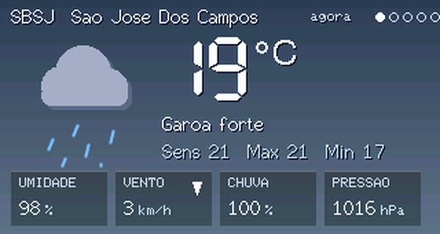
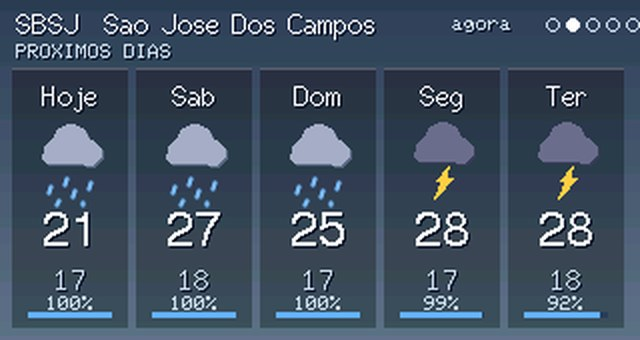
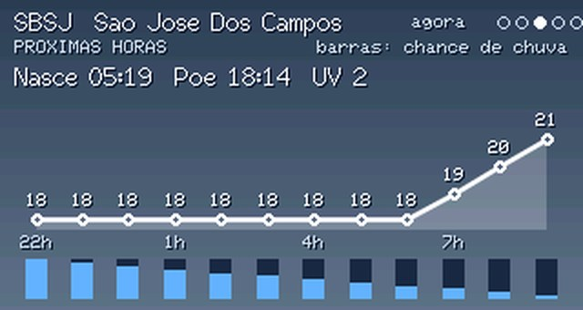
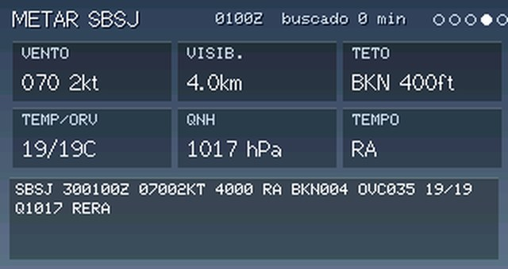
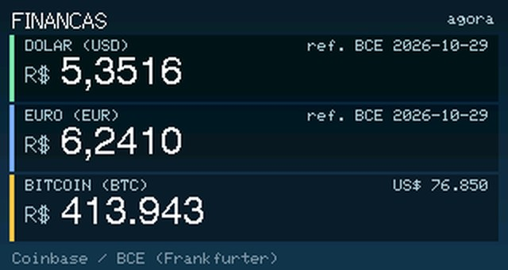
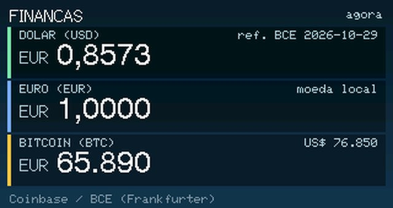
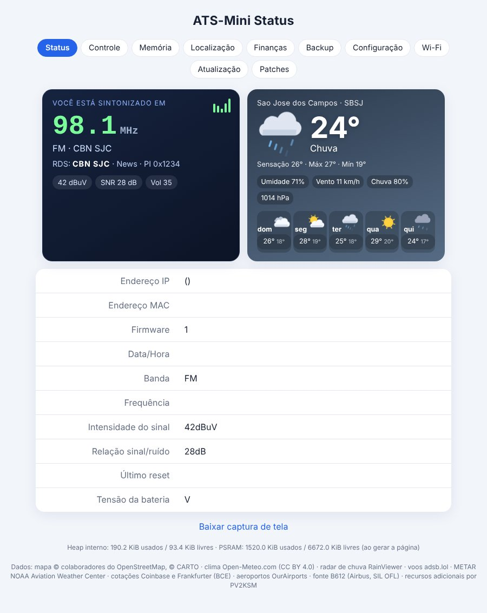
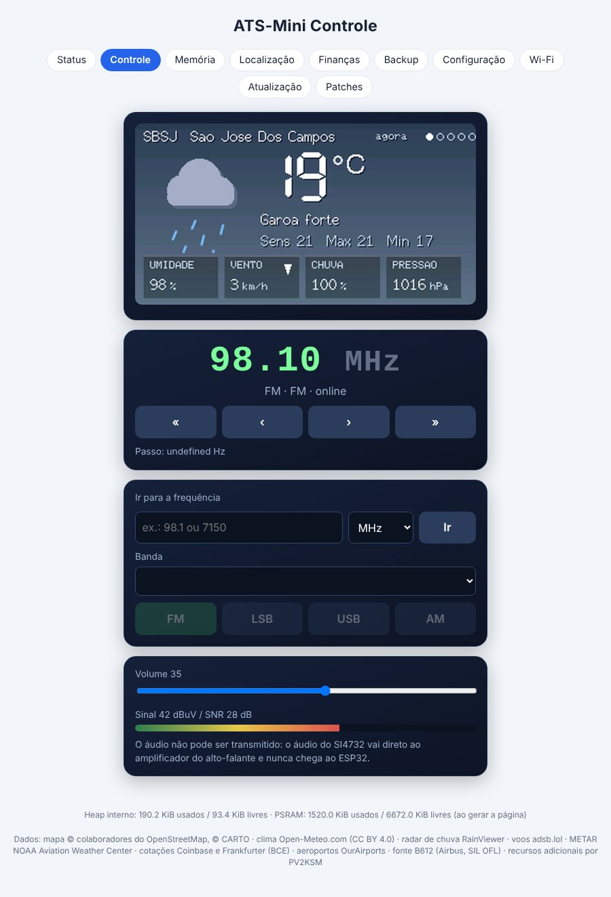
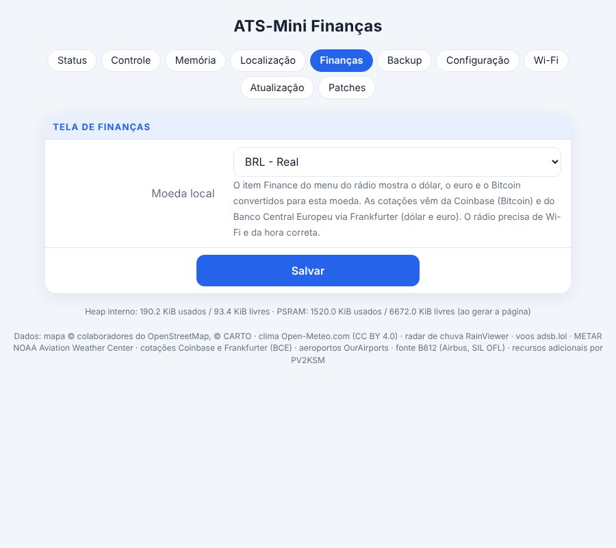
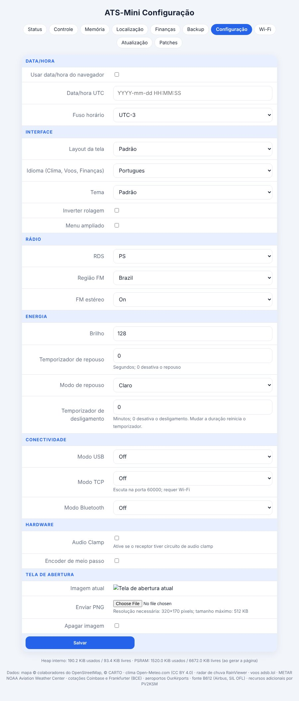

# Mod PV2KSM r30 - manual do usuário

Mod comunitário não oficial baseado no ATS-Mini v2.45 (MIT). Só a variante **OSPI** foi testada em hardware real (e a r30 em si ainda não foi testada no rádio: veja *O que não foi testado*). O que não está descrito aqui funciona como no [manual oficial](../source/manual.md).

Other languages: [EN](MANUAL-en.md) · [ES](MANUAL-es.md)

## Idioma

As telas do mod (Flights, Weather, Finance, Network, METAR, radar de chuva) e a interface web falam **inglês, português e espanhol**. Instalação nova começa em **inglês**.

1. No rádio: **Menu → Settings → Language**, gire para escolher, clique para confirmar.
2. No navegador: **Configuração → Idioma** e Salvar.

As telas do rádio usam só letras ASCII (sem acentos) porque as fontes internas não têm acentos. Mensagens de status já na tela mantêm o idioma antigo até a próxima atualização. A escolha fica gravada no rádio e entra no arquivo de Backup.

## Controles (encoder)

| Ação | O que faz |
|---|---|
| Girar | Sintonizar, mover nos menus, mudar valores |
| Clique | Abrir o menu / entrar no item / voltar |
| Toque curto (segurar ~0,5 s) | Ação de contexto (veja cada tela) |
| Toque longo (>2 s) | Ligar/desligar repouso |

## Menu principal

Mode · Band · Volume · VFO A/B · Step · Seek · Scan · Memory · Squelch · Bandwidth · AGC/ATTN · AVC · SoftMute · **Flights** · **Weather** · **Finance** · **Network** · Settings

Itens em negrito são novos neste mod.

### Flights (voos)
Aeronaves ao vivo ao redor da sua posição (adsb.lol) num mapa com aeroportos próximos.
- Girar: seleciona a aeronave seguinte/anterior.
- Toque curto: abre/fecha o painel de detalhes.
- Clique: sai da tela.
- Cores indicam altitude: laranja < 5 000 ft, amarelo < 15 000 ft, verde < 30 000 ft, azul acima.
- Defina sua posição na aba web **Localização**.
- Limitação: em regiões densas fica cheio e pode ficar lento ou falhar.

### Weather (clima)
Gire para mudar de página: **agora → próximos dias → próximas horas → METAR → radar de chuva**. Toque curto no radar dá zoom; clique sai. Os dados só são buscados com a tela aberta (precisa de Wi-Fi e hora correta). O METAR usa o ICAO definido em **Localização**.

### Finance (finanças)
Mostra o **dólar, o euro e o Bitcoin** convertidos para a sua moeda local (escolha na aba web **Finanças**). Cotações: Coinbase (Bitcoin) e Banco Central Europeu via Frankfurter (dólar, euro). O formato dos números segue o idioma (EN `1,234.56`; PT/ES `1.234,56`).

### Network (rede)
Duas páginas (gire): Network (Wi-Fi, IP, canal, MAC, hora, tempo ligado, memória, último reset) e Services (estado de Flights, Map, Weather, METAR, Radar, Finance).

## Interface web (abra o IP do rádio no navegador)

| Aba | Uso |
|---|---|
| Status | Cartão "Você está sintonizado em", clima, informações do sistema |
| Controle | Tela do rádio ao vivo, sintonia, ir para frequência, banda/modo, volume |
| Memória | Editar os slots de memória |
| Localização | ICAO do aeroporto ou lat/lon, nome, rótulo, opções do mapa |
| Finanças | Moeda local |
| Backup | Exportar/importar configurações; deixe "incluir redes Wi-Fi" **desmarcado** se for compartilhar o arquivo |
| Configuração | Data/hora, layout, **idioma**, tema, energia, hardware |
| Wi-Fi | Modo e redes salvas |
| Atualização | Verificar atualizações / envio manual de `.bin` |
| Patches | Conjuntos de patches experimentais do Si4732 |

## Imagens

**Telas do rádio (simulações)**

**Páginas web (simuladas com dados de exemplo)**

## Chave do mapa (opcional)

O fundo do mapa precisa da sua própria chave gratuita do CARTO basemaps (<https://carto.com/basemaps/apikey/>). Digite em **Localização**; ela fica só no seu rádio e nunca é mostrada de volta. O firmware nunca contém chave.

## Instalação

Baixe o `.bin` da sua variante na página da release e, na interface web do rádio, vá em **Atualização → Envio manual**. A OSPI é a variante testada; QSPI e LilyGO T-Embed só foram compiladas.

## O que não foi testado

- A r30 (troca de idioma, Finance com euro, páginas web traduzidas) **ainda não foi testada no rádio**.
- Builds QSPI e LilyGO T-Embed: só compiladas.
- Layouts Cockpit e Avionics: precisam de mais testes em hardware.
- Importação de backup não foi testada em hardware.

## Limitações conhecidas

- Flights em regiões densas não funciona bem.
- Com bateria fraca o rádio pode reiniciar sem parar com o Wi-Fi ligado (carregue ou desligue o Wi-Fi). Um usuário relatou ~170 mA com Wi-Fi (relatado, não medido por mim).
- O Open-Meteo é gratuito apenas para uso não comercial; os outros serviços mantêm seus termos (veja `AVISOS-DE-TERCEIROS.md`).

## Planos

Opção de unidades (km/h, mph, kt), segundo local de clima e uma **versão lite** (mapa mais leve ou sem mapa). Sem datas.

Sugestões e relatos de erro: https://github.com/PV2KSM/ats-mini-pv2ksm/issues — 73, PV2KSM
