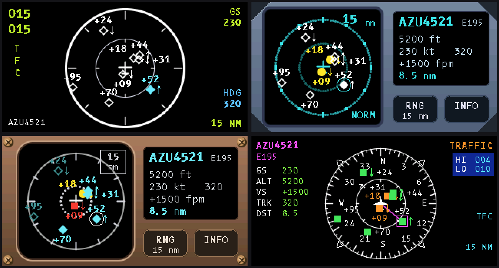
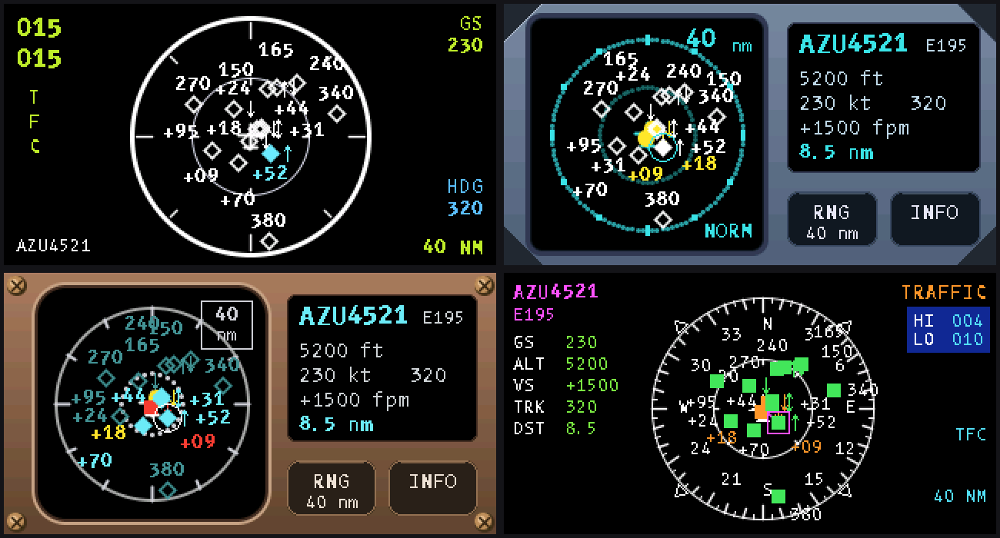
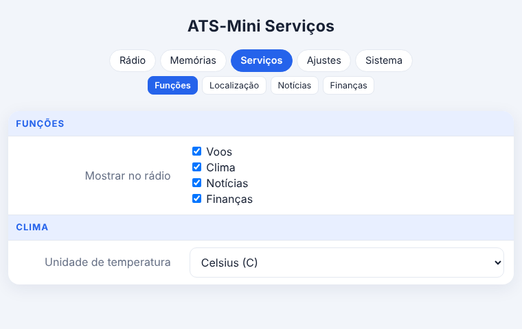
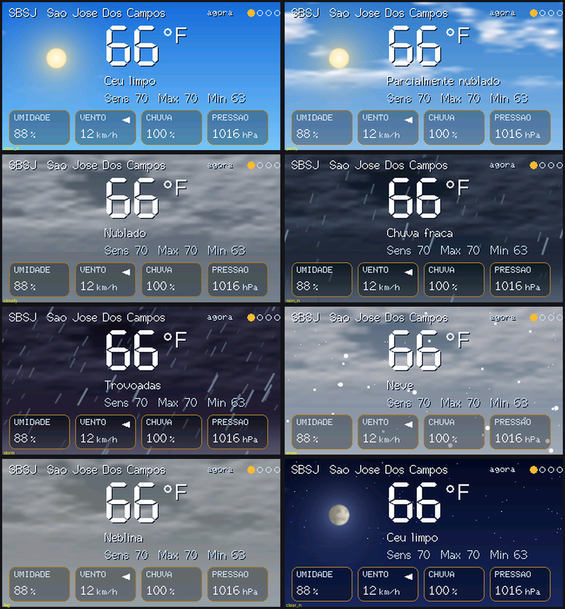
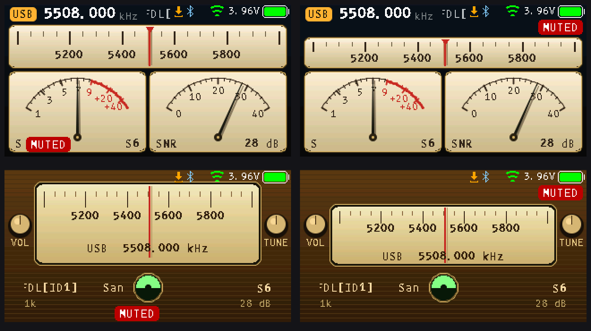

# ATS-Mini v2.45 — PV2KSM r30D (community mod)

**Unofficial community mod by PV2KSM, free, no warranty.** Based on the open-source [ESP32-SI4732 / ATS-Mini](https://github.com/esp32-si4732/ats-mini) firmware v2.45 (MIT, see `LICENSE` and `NOTICE.txt`). Not affiliated with or endorsed by the original project.

## Tested hardware — read first
| Variant | Status |
|---|---|
| **ATS-Mini, OSPI** | **Tested** by PV2KSM on a real radio |
| ATS-Mini, QSPI | Compiled only — **not tested on hardware** |
| LilyGO T-Embed (Si473x) | Compiled only — **not tested on hardware** |

Please report results for QSPI / LilyGO in *Issues*.

## What's new in r30D

### 1. Flights radar styles
Besides the map, four cockpit-inspired looks: **A32X**, **ATCAS**, **BTCAS**, **B7X**, with traffic colours by risk and labels placed so they do not overlap. Pick it on the web **Flights** page or on the radio at **Visual → Flights radar** (a live preview is shown behind the menu).

### 2. Services reorganised
Web **Weather**, **Flights** and **News** pages, each with a "show on the radio" Yes/No. Temperature unit now lives on the Weather page; **Finance** moved under News and lets you choose the currency and three cards (USD, EUR, GBP, BTC, ETH). Weather uses a **city** (with optional country code); Flights uses an airport **ICAO or IATA** code.

### 3. Realistic weather sky
Procedural clouds, sun, moon, stars, rain, snow, fog and lightning on the Weather screen.

### 4. News with accents, layouts
News headlines use a smooth font with accented letters. NAnalog and Vintage layouts share the same frame.

### 5. Turn off what you do not want
Every service can be hidden from the radio: on the web **Weather**, **Flights** and **News** pages choose *Show on the radio: No*, and that item disappears from the radio menu. Finance cards and the radar look are also optional, so nobody is forced to use a feature they do not like.

### Fixes
- Thanks to Dave (G8PTN) for the reports in [issue #5](https://github.com/PV2KSM/ats-mini-pv2ksm/issues/5): the layout overlaps (station/EiBi names, SQL/MUTE chips, top banner) fixed in r30C are now confirmed on the OSPI radio, and the new NAnalog and Vintage layouts follow the same frame. Please tell me if any layout still looks wrong on yours.
- Saving the web Config page no longer reboots the radio (larger web server task stack).
- Full PT/EN/ES review of every new text.

## Files
- `ats-mini-v2.45-ospi-r30D-ota.bin` — ATS-Mini OSPI
- `ats-mini-v2.45-qspi-r30D-ota.bin` — ATS-Mini QSPI
- `ats-mini-v2.45-lilygo-t-embed-r30D-ota.bin` — LilyGO T-Embed
- `SHA256SUMS.txt`
