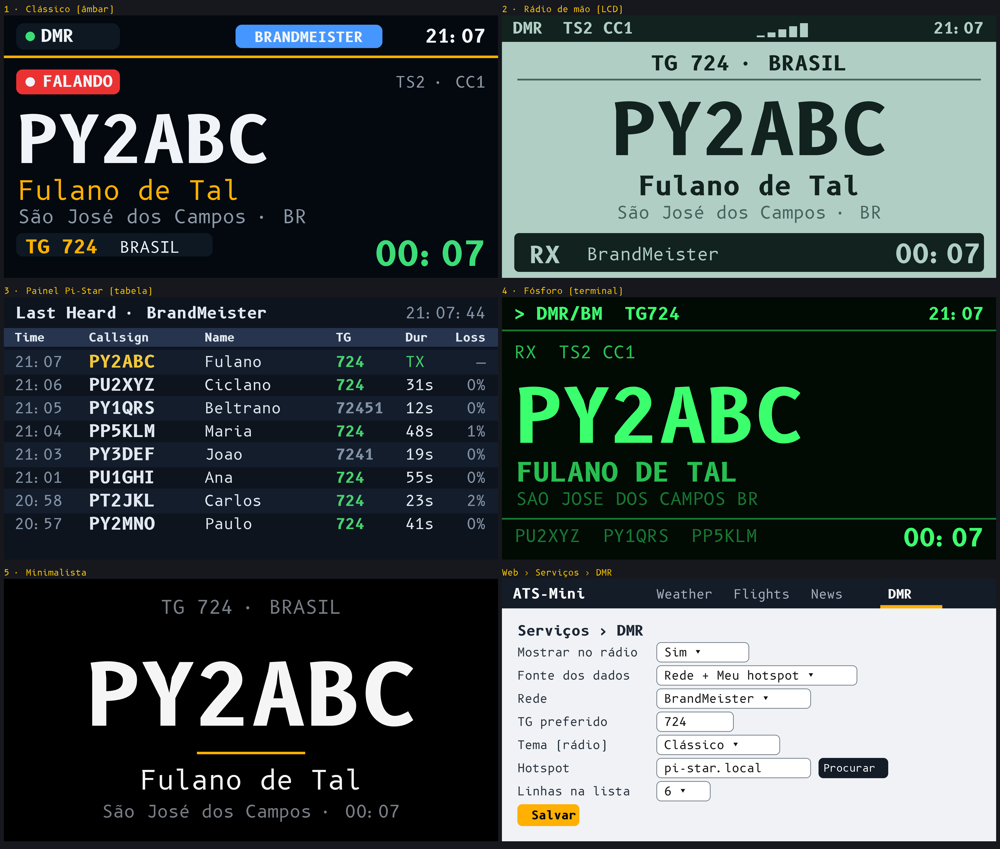

# ATS-Mini v2.45 — PV2KSM r30E (community mod)

**Unofficial community mod by PV2KSM, free, no warranty.** Based on the open-source [ESP32-SI4732 / ATS-Mini](https://github.com/esp32-si4732/ats-mini) firmware v2.45 (MIT, see `LICENSE` and `NOTICE.txt`). Not affiliated with or endorsed by the original project.

## Tested hardware — read first
| Variant | Status |
|---|---|
| **ATS-Mini, OSPI** | **Tested** by PV2KSM on a real radio |
| ATS-Mini, QSPI | Compiled only — **not tested on hardware** |
| LilyGO T-Embed (Si473x) | Compiled only — **not tested on hardware** |

Please report results for QSPI / LilyGO in *Issues*.

## What's new in r30E

### 1. ID DMR — experimental, **hotspot only**
> **Important:** ID DMR works **only with a Pi-Star or WPSD hotspot on your local network**. It reads the hotspot's own dashboard page (`/mmdvmhost/lh.php`). There is **no internet feed** (no BrandMeister / TGIF). Other hotspots (OpenSpot, etc.) are **not supported**. It is **hidden by default**.

- Shows who is talking: callsign, **DMR ID**, name, city, talkgroup, duration, with the **country flag** (51 flags, by DMR ID or callsign prefix).
- Nine themes: Classic, Handheld, Pi-Star, Phosphor, Minimal, Flag Hero, Badge, Rows, Paper (choose on the web page or in *Visual → DMR theme*, with live preview).
- **Setup:** web **ID DMR** page → "Show on the radio: Yes" → type your hotspot address. Use the hotspot **IP** (for example `192.168.0.45`); `pi-star.local` also works if your router/network resolves it, but a fixed IP is the reliable option.
- **Privacy:** to show name and city the radio asks `radioid.net` for each new callsign heard, so those callsigns are sent to that site. If you do not want that, leave ID DMR off.
- Font: Inter (SIL OFL), see `AVISOS-DE-TERCEIROS.md`.

### 2. Bluetooth + Wi-Fi together
Thanks to Dave (G8PTN): turning Bluetooth on with Wi-Fi connected rebooted the radio. Now the radio checks free RAM before starting Bluetooth (and tells you if it cannot), a crash guard switches Bluetooth off after a crash, and TLS memory lives in PSRAM so weather, flights, news and finance keep working after Bluetooth has been used. Tested by the author with all services running.

### 3. Local time in clock themes
Reported by Haranochi: the Clock theme showed UTC. It now shows local time using your UTC offset.

### 4. Web and memory
- Wind direction arrow on the web Weather page.
- Background tasks merged into two shared workers (≈60 KB internal RAM freed).
- Full EN/PT/ES translations of the new texts.

## Files
- `ats-mini-v2.45-ospi-r30E-ota.bin` — ATS-Mini OSPI
- `ats-mini-v2.45-qspi-r30E-ota.bin` — ATS-Mini QSPI
- `ats-mini-v2.45-lilygo-t-embed-r30E-ota.bin` — LilyGO T-Embed
- `SHA256SUMS.txt`
